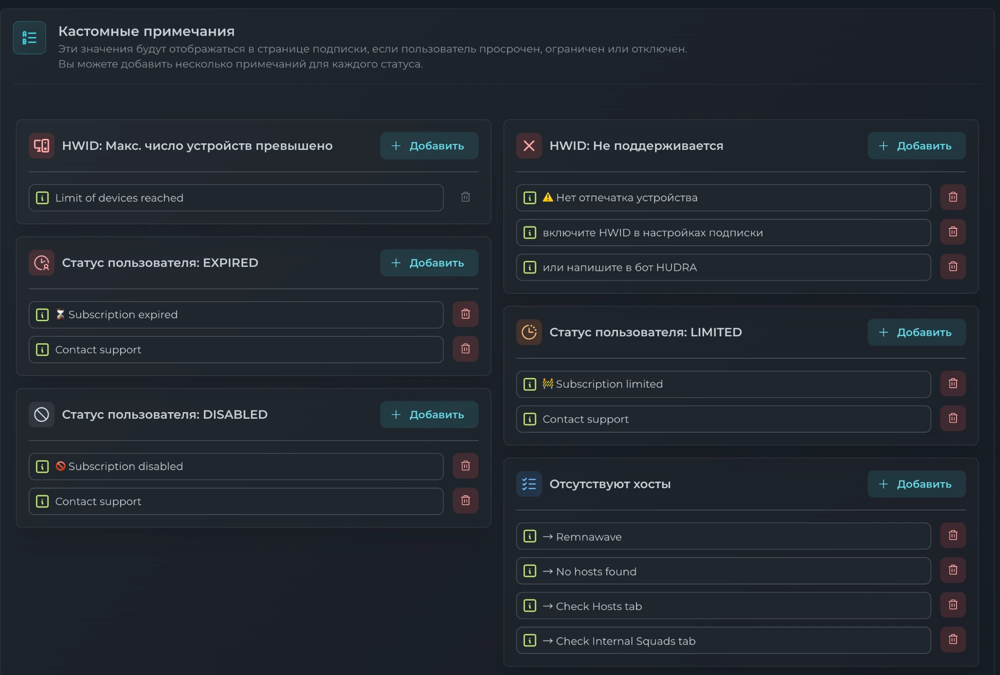
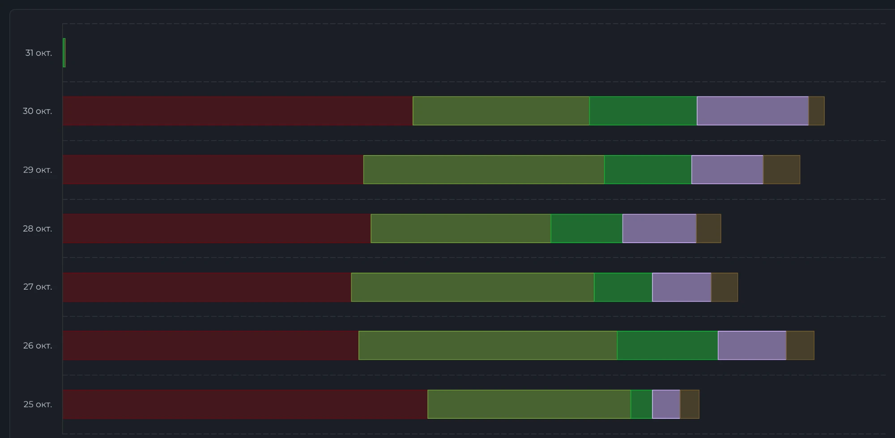

<div align="center">

# Remnawave: установка и эксплуатация

**Панель, узел, страница подписки — и то, что ломается через два месяца**

[](LICENSE)
[](https://github.com/hudravpn/remnawave-notes/commits/main)
[](https://github.com/hudravpn/remnawave-notes/issues)

[Установка](#установка) · [Что ломается потом](#что-ломается-потом) · [Проверки](#что-проверять-автоматически) · [HUDRA VPN](https://github.com/hudravpn)

</div>

---

## Кому это

Вы ставите Remnawave впервые или уже поставили и хотите понять, что упустили.

**Это не установщик.** Установщики есть, живые и хорошие:
[официальная документация](https://docs.rw),
[remnawave-reverse-proxy](https://github.com/eGamesAPI/remnawave-reverse-proxy),
[remnawave-scripts](https://github.com/DigneZzZ/remnawave-scripts).

Здесь — **порядок действий и места, где оно ломается**. Первое нигде не
написано целиком, второе выясняется болезненно и по одному. Писали те, кто
держит Remnawave в работе не первый месяц.

> [!NOTE]
> Команды взяты из официальной документации и сверены с ней. Панель
> развивается; если команда здесь разошлась с документацией — права
> документация.

---

## Содержание

- [Из чего это состоит](#из-чего-это-состоит)
- [Требования](#требования)
- [Установка](#установка)
  - [1. Домены и DNS](#1-домены-и-dns)
  - [2. Панель](#2-панель)
  - [3. Обратный прокси](#3-обратный-прокси)
  - [4. Узел](#4-узел)
  - [5. Страница подписки](#5-страница-подписки)
  - [6. Проверка](#6-проверка-что-всё-правда-работает)
  - [7. Резервные копии](#7-резервные-копии)
- [Что ломается потом](#что-ломается-потом)
- [Что проверять автоматически](#что-проверять-автоматически)
- [Чего здесь нет](#чего-здесь-нет)
- [Лицензия](#лицензия)

---

## Из чего это состоит

Четыре разные вещи, и половина бед — от того, что их путают.

| | Что делает | Через неё идёт трафик людей |
|---|---|---|
| **Панель** | пользователи, подписки, конфигурация, база | нет |
| **Узел** | точка выхода, внутри Xray-core | **да** |
| **Страница подписки** | то, что открывает клиентское приложение | нет |
| **Обратный прокси** | TLS и раздача по доменам | нет |

Панель **не содержит Xray** — он живёт на узле. Одна панель без узлов не даёт
подключения вообще.

> [!TIP]
> **Панель и узел на одной машине** — рабочая, но плохая конфигурация. Узел
> переставляют и меняют, когда его начинают глушить; панель не трогают
> месяцами. Связав их, вы будете переносить базу каждый раз, когда нужно
> сменить точку выхода.

---

## Требования

**Машина под панель.** Ubuntu или Debian, 2 ядра и 4 ГБ (минимум 2 ГБ), 20 ГБ
диска. Нагрузки почти нет — важна надёжность площадки: потеря панели это
потеря всех подписок разом.

**Машина под узел.** Ubuntu или Debian, от 1 ядра и 1 ГБ. Решает **не
процессор, а канал**: гигабитный порт у плохого провайдера хуже
стомегабитного у хорошего.

**Домен.** Два имени: под панель и под страницу подписки.

**Docker** на обеих машинах:

```bash
sudo curl -fsSL https://get.docker.com | sh
```

---

## Установка

### 1. Домены и DNS

**Первым делом, до всего остального.** Записи должны разойтись до того, как вы
начнёте выпускать сертификаты.

- `panel.example.com` → адрес машины с панелью
- `sub.example.com` → адрес машины со страницей подписки

Поднять панель «пока на IP, домен потом» — значит переделывать всё, включая
ссылки подписок, которые уже разошлись людям.

```bash
dig +short panel.example.com
```

### 2. Панель

**Скачать файлы:**

```bash
mkdir /opt/remnawave && cd /opt/remnawave
curl -o docker-compose.yml https://raw.githubusercontent.com/remnawave/backend/refs/heads/main/docker-compose-prod.yml
curl -o .env https://raw.githubusercontent.com/remnawave/backend/refs/heads/main/.env.sample
```

**Сгенерировать ключи.** Значения из примера использовать нельзя:

```bash
sed -i "s/^APP_SECRET=.*/APP_SECRET=$(openssl rand -hex 64)/" .env
sed -i "s/^METRICS_PASS=.*/METRICS_PASS=$(openssl rand -hex 64)/" .env
sed -i "s/^WEBHOOK_SECRET_HEADER=.*/WEBHOOK_SECRET_HEADER=$(openssl rand -hex 64)/" .env
```

**Сменить пароль базы** — он тоже из примера:

```bash
pw=$(openssl rand -hex 24)
sed -i "s/^POSTGRES_PASSWORD=.*/POSTGRES_PASSWORD=$pw/" .env
sed -i "s|^\(DATABASE_URL=\"postgresql://postgres:\)[^\@]*\(@.*\)|\1$pw\2|" .env
```

**Прописать домены** в `.env`:

```
FRONT_END_DOMAIN=panel.example.com
SUB_PUBLIC_DOMAIN=panel.example.com/api/sub
```

`SUB_PUBLIC_DOMAIN` поправим на шаге 5.

**Запустить:**

```bash
docker compose up -d && docker compose logs -f -t
```

> [!WARNING]
> **Не открывайте порты панели наружу.** Сервисы слушают только `127.0.0.1`, и
> так должно остаться: доступ снаружи даёт обратный прокси, и только он.

### 3. Обратный прокси

Без него панель работать не должна: он терминирует TLS и прячет сервисы.

Готовые конфигурации для Caddy, nginx и Angie —
в [документации](https://docs.rw/install/reverse-proxies/). Переписывать их
здесь не буду: они правятся вместе с панелью, и устаревшая копия хуже
отсутствующей.

Проверка сразу после:

```bash
curl -sI https://panel.example.com | head -1
```

### 4. Узел

**Завести в панели:** Nodes → Management → **+**. Поле **Node Port** — порт,
на котором узел слушает служебные запросы от панели, больше он ни для чего не
нужен. Нажмите **Copy docker-compose.yml**.

**Поставить на машине узла:**

```bash
mkdir /opt/remnanode && cd /opt/remnanode
nano docker-compose.yml   # вставьте скопированное из панели
docker compose up -d && docker compose logs -f -t
```

Вернитесь в карточку узла → **Next** → выберите Config Profile → **Create**.

**Сразу закройте порт.** Служебный порт должен быть доступен только с адреса
панели:

```bash
ufw allow 22/tcp
ufw allow from <адрес-панели> to any port <NODE_PORT> proto tcp
ufw enable
```

> [!CAUTION]
> **Замените `latest` на конкретную версию образа.** Конфигурация из панели
> приходит с `image: remnawave/node:latest`. Иначе однажды ночью узлы
> обновятся сами, встретят несовместимость с вашей версией панели и отвалятся
> — все разом. Обновляйте по одному, убедившись, что первый подключился.

**Проверьте первый узел, прежде чем заводить второй.** Одна и та же ошибка,
повторённая на шести машинах, ищется в шесть раз дольше.

### 5. Страница подписки

Нужна, чтобы люди не видели домен вашей панели. Ставится рядом с панелью или
отдельно — [инструкция](https://docs.rw/install/remnawave-subscription-page/).

После установки поправьте в `.env` панели `SUB_PUBLIC_DOMAIN=sub.example.com`
и перезапустите её.

**Пока вы в настройках подписки — загляните в «Кастомные примечания».** Это
то, что увидит человек, у которого подписка кончилась, исчерпан трафик или
превышено число устройств. По умолчанию он не видит ничего — пустую страницу
или список без серверов, — и идёт писать вам «у вас всё сломалось». Две строки
текста здесь снимают заметную часть обращений в поддержку.



Отдельно стоит заполнить «Отсутствуют хосты»: это состояние означает ошибку в
конфигурации, а не в подписке человека, и подсказка нужна уже вам.

### 6. Проверка, что всё правда работает

Самый пропускаемый шаг — и самый дорогой.

> [!IMPORTANT]
> **Страница подписки отдаёт разное в зависимости от того, кто спросил.**
> Клиентское приложение присылает свой `User-Agent` и получает конфиг в своём
> формате; браузер получает человеческую страницу. Поэтому **`curl` и браузер
> не являются проверкой**: страница откроется и тогда, когда приложение уже
> ничего не получает.

Минимум перед тем, как звать людей:

1. завести тестового пользователя;
2. открыть его ссылку **в настоящем клиенте**, а не в браузере;
3. подключиться и убедиться, что внешний адрес сменился на адрес узла;
4. посмотреть в панели, что трафик по этому пользователю **считается**.

Четвёртый пункт важен: подключение может работать, а учёт — нет, и вы узнаете
об этом, когда начнёте продавать лимиты.

### 7. Резервные копии

**До того, как появятся первые платящие люди, а не после.**

Копировать надо дамп базы и каталог панели с `.env`. Без `.env`
восстановленная база бесполезна: ключи не совпадут. Готовое решение —
[remnawave-backup-restore](https://github.com/distillium/remnawave-backup-restore).

Три вещи, которые выясняются в худший момент:

- **Копия на той же машине — не копия.** Машину теряют целиком, вместе с
  диском. Архив должен уезжать наружу.
- **Версия PostgreSQL** на машине, куда восстанавливаете, должна совпадать с
  той, где делали дамп. Иначе восстановление падает на половине.
- **Роли базы в дамп не попадают.** База поднимется, а приложение к ней не
  подключится.

Последние два мы узнали на репетиции восстановления. **Проведите её.** Копия,
которую ни разу не разворачивали, — это не копия, а надежда.

---

## Что ломается потом

Установка — начало работы, а не её конец. Вот что ломалось молча.

### Сертификаты продлеваются, но ничего не перезапускается

`acme.sh` обновляет файлы, хук перезагружает не тот сервис — и через 90 дней
всё падает. Проверка «сертификат на месте» при этом проходит: файл-то обновился.

**Проверяйте не файл, а срок, который отдаёт живой сервер:**

```bash
echo | openssl s_client -connect panel.example.com:443 2>/dev/null \
  | openssl x509 -noout -enddate
```

### Разошедшиеся часы

Время, ушедшее на узле, ломает TLS способом, который невозможно понять по
симптомам: всё «почти работает». Проверьте NTP на каждой машине.

### Логи съедают диск

Включили логи Xray на узле — **настройте ротацию сразу**, иначе кончится диск.
Пример конфигурации logrotate есть в
[документации узла](https://docs.rw/install/remnawave-node/).

### Квоты трафика

Считайте их **в днях до исчерпания, а не в процентах**. «80% израсходовано» не
говорит ничего, а «кончится через четыре дня» — говорит всё.

Смотрите не на сумму, а на раскладку по дням и узлам: перекос видно сразу, и
он почти всегда означает, что один узел тянет за остальных — потому что
соседние перестали отвечать, а люди переключились.



---

## Что проверять автоматически

Четыре проверки. Каждая однажды спасла бы нам день, а о трёх поломках мы
узнали не от них, а от людей.

| Что | Почему не очевидно |
|---|---|
| Проходит ли через узел **настоящее соединение** | ping и открытый порт ничего не доказывают |
| Сколько **дней осталось сертификатам** | руками это не проверяет никто |
| Отдаёт ли страница подписки **конфиг**, а не заглушку | браузером этого не видно |
| **Уехала ли копия** с машины | «копия создалась» и «копия сохранилась» — разные события |

---

## Чего здесь нет

Здесь нет ничего про **обход блокировок**: какие протоколы использовать под
какую страну, под что маскировать трафик, какие имена проходят, а какие гасят.

Это не кокетство. Всё, что пишут в таких руководствах, читают и те, кто эти
блокировки ставит, — и каждая опубликованная подробность живёт после этого
недели, а не месяцы.

Если вам это нужно, придётся выяснять самостоятельно и проверять **изнутри той
страны, для которой вы это делаете**. Узел, прекрасно отвечающий из Европы,
может быть наглухо закрыт для человека с телефоном в другом месте, и снаружи
этого не видно вообще.

---

## Лицензия

[CC BY-SA 4.0](LICENSE). Берите, переводите, вставляйте к себе — с указанием
авторства и на тех же условиях.

## Кто это написал

[HUDRA VPN](https://github.com/hudravpn) — сервис для России, работающий в том
числе в дни, когда в регионах выключают мобильный интернет.

Знаете грабли, которых здесь нет, — заводите
[issue](https://github.com/hudravpn/remnawave-notes/issues). Заметки живые.
